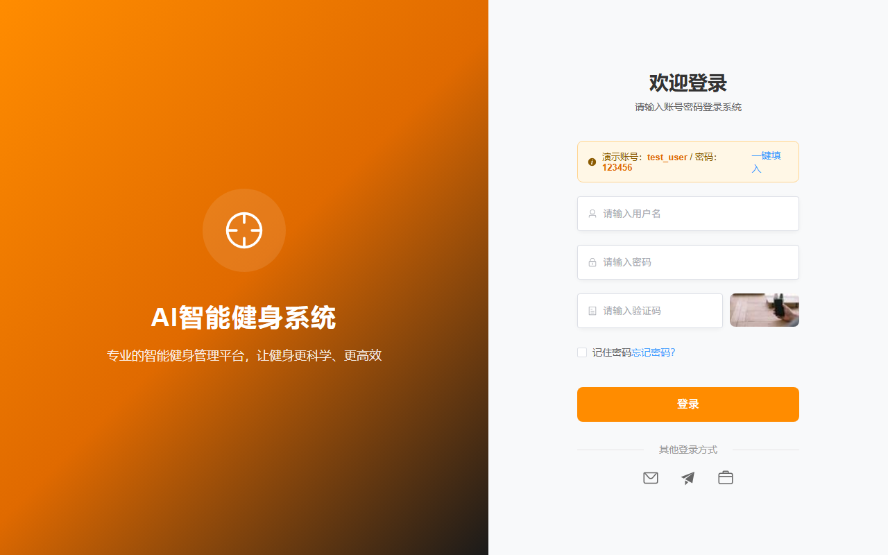

# AiroFit 智能健身系统

一款基于 AI 的智能健身管理系统，采用前后端分离架构，集成食物热量识别、动作姿态识别、3D 肌肉模型、社区互动、健身商城等完整业务功能。



## 功能特性

- 🍎 **AI 食物热量识别**：上传食物图片，调用通义千问多模态大模型识别食物种类，结合用户输入重量计算热量与营养成分
- 🏃 **AI 动作计数**：基于 MediaPipe Pose 姿态检测，通过摄像头实时识别深蹲、臂展、俯卧撑、开合跳、高抬腿等动作并自动计数
- 🦴 **3D 肌肉模型**：基于 Three.js 的交互式 3D 人体肌肉模型，支持旋转、缩放
- 👥 **社区互动**：发布健身动态、点赞、评论、经验分享
- 🛒 **健身商城**：商品浏览、分类筛选、购物车、下单
- 📊 **数据统计**：近 7 天热量趋势图、每日热量预算
- 👤 **个人中心**：头像昵称、身体数据、运动记录、热量预算计算

## 技术栈

| 层次 | 技术 |
|------|------|
| 前端框架 | Vue3 + Vite |
| UI 组件库 | Element Plus |
| 图表 | ECharts |
| 3D 模型 | Three.js |
| 动作识别 | MediaPipe Pose |
| 后端框架 | Python Flask |
| 数据库 | SQLite（SQLAlchemy ORM） |
| AI 模型 | 通义千问 qwen3-vl-plus |

## 项目结构

```
AiroFit-main/
├── backend/          # Flask 后端
│   ├── app.py        # 主程序（API + 数据库模型）
│   ├── requirements.txt
│   └── static/       # 上传文件
└── frontend/         # Vue3 前端
    ├── src/
    │   ├── views/    # 页面组件
    │   ├── layouts/  # 布局
    │   ├── router/   # 路由
    │   └── config.js # API 配置
    └── package.json
```

## 快速开始

### 环境要求

- Python 3.11+
- Node.js 18+
- npm

### 后端启动

```bash
cd backend
pip install -r requirements.txt
python app.py
# 运行在 http://127.0.0.1:5000
```

### 前端启动

```bash
cd frontend
npm install
npm run dev
# 运行在 http://localhost:5173
```

### AI 识别配置

食物识别功能需要通义千问 API Key，在 `backend/.env` 中配置：

```
DASHSCOPE_API_KEY=你的密钥
```

## 登录信息

- 演示账号：`test_user`
- 密码：`123456`

## 核心算法

### 每日热量预算（Mifflin-St Jeor 公式）

```
男性：BMR = 10 × 体重(kg) + 6.25 × 身高(cm) - 5 × 年龄 + 5
女性：BMR = 10 × 体重(kg) + 6.25 × 身高(cm) - 5 × 年龄 - 161
```

### 运动消耗（MET 公式）

```
消耗热量 = MET值 × 体重(kg) × 时长(小时)
```
